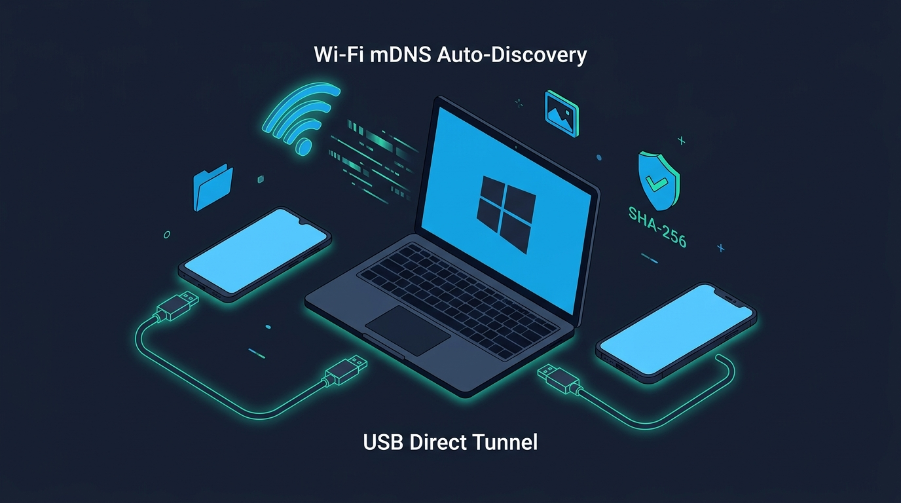

# DeviceBridge

Native cross-platform file-sharing and live screen-mirroring bridge for **Windows** (`windows_host`), **Android**, and **iOS** (`mobile_companion`), backed by a pure-Dart SHA-256 streaming protocol (`shared_protocol`).

## Documentation
- **[User Guide & Connection Tutorial (with Pictures)](docs/USER_GUIDE.md)** — step-by-step instructions for Windows, Android (Wi-Fi & USB + `scrcpy`), and iOS (Wi-Fi & USB + AirPlay).

## Monorepo Packages
- [`shared_protocol`](shared_protocol): Pure Dart control messages, binary `ChunkFrame` codec, and incremental SHA-256 verification.
- [`windows_host`](windows_host): Native Flutter Windows desktop app (`desktop_drop`, `super_drag_and_drop`, `bonsoir`, `win32` HWND docking, Inno Setup installer).
- [`mobile_companion`](mobile_companion): Native Flutter Android & iOS companion app (`shelf` + `shelf_web_socket`, `bonsoir`, `media_store_plus`, `flutter_local_notifications`).

