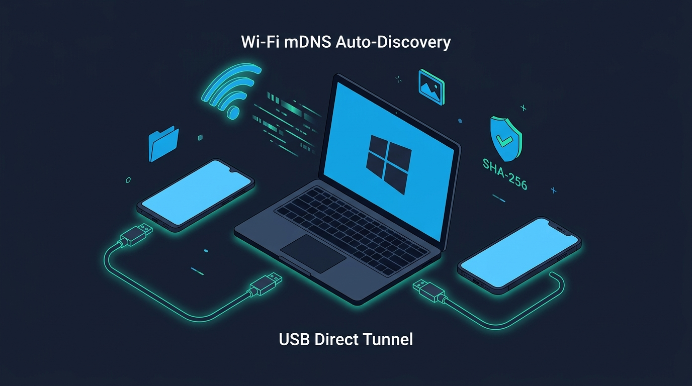
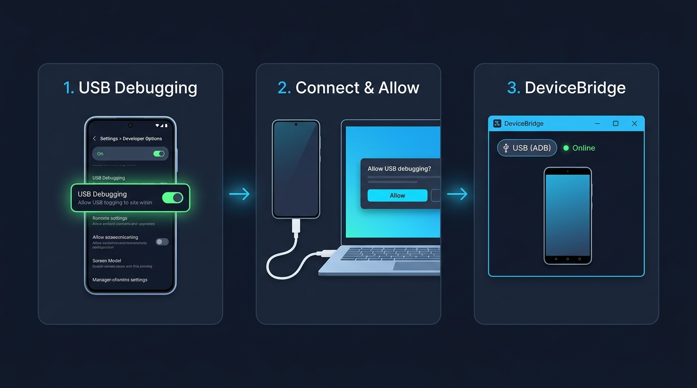
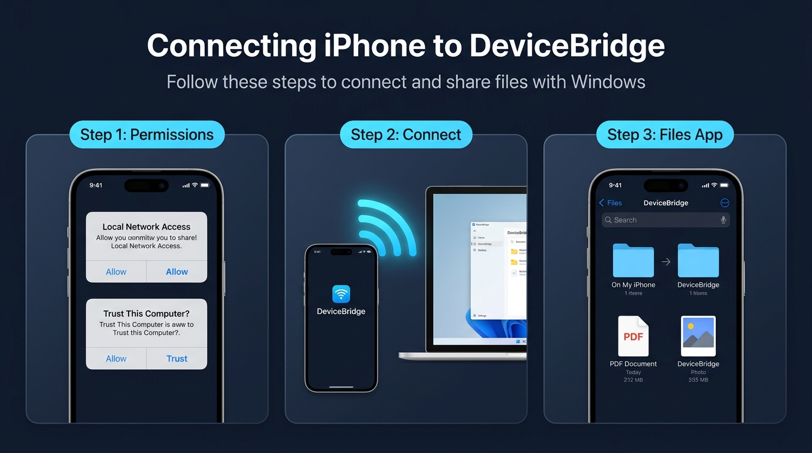

# DeviceBridge User Guide

Welcome to **DeviceBridge** — a fast, native file-sharing and screen-mirroring bridge between your **Windows laptop** and your **Android** or **iPhone / iPad** devices.

---

## Step 1: Install DeviceBridge on Your Devices

1. **Windows Laptop:** Run `DeviceBridge-Windows-1.0.0-Setup.exe` and finish the setup wizard, then open **DeviceBridge** from the Start Menu or Desktop shortcut.
2. **Android Phone / Tablet:** Copy `DeviceBridge-Android-1.0.0.apk` to your phone, tap it, and allow **"Install unknown apps"** if prompted. Open **DeviceBridge Companion**.
3. **iPhone / iPad:** Install `DeviceBridge-iOS-1.0.0-unsigned.ipa` (signed with your Apple ID via AltStore, Sideloadly, or Xcode). Open **DeviceBridge Companion**.

> **Important:** When you first open **DeviceBridge Companion** on your phone, allow any **Notifications**, **Photos / Media**, and **Local Network** permission prompts so transfers can save properly and alert you when finished.

---

## Step 2: Choose How to Connect Your Device

DeviceBridge supports both **Wi-Fi (no cables)** and **USB Cable (no Wi-Fi needed)**.

### Option A: Connect an Android Phone over Wi-Fi (Easiest)

1. Make sure your **Windows laptop** and **Android phone** are on the **same Wi-Fi network**.
2. Open **DeviceBridge Companion** on your Android phone.
   - Check that the status card says **`Listening on port 49152`** and **`mDNS Active`**.
3. Open **DeviceBridge** on your Windows laptop.
4. Look at the connection card on the right — your phone will appear automatically as a clickable chip labeled **`<Phone Name> • Wi-Fi (mDNS)`**.
5. Click that chip (or click **Connect**). Once connected, the header turns green/teal and shows **`Connected: <Phone Name> (android)`**.

---

### Option B: Connect an Android Phone via USB Cable (+ Live Screen Mirroring)

Use a USB cable when Wi-Fi is unavailable, slow, or blocked (like on public/office Wi-Fi).

1. **Turn on USB Debugging on your Android phone (one-time setup):**
   - Open **Settings -> About phone -> Software information**.
   - Tap **Build number** **7 times** until you see *"You are now a developer!"*.
   - Go back to **Settings -> Developer options** and turn **USB debugging** **ON**.
2. **Plug your Android phone into your Windows laptop** using a data-capable USB cable.
3. On your phone screen, tap **Allow** on the **"Allow USB debugging?"** pop-up (check *Always allow from this computer* for convenience).
4. Open **DeviceBridge Companion** on the phone and **DeviceBridge** on Windows.
5. In the Windows app, click the **`<Phone Model> (USB) • USB (ADB)`** chip and click **Connect**.
6. *(Optional)* Click the **Mirror** button at the top of the left **Mirror & Drop** panel to view your live Android screen directly inside DeviceBridge!
   - You can click **Pop out mirror** / **Dock mirror** to detach or re-attach the live phone screen.

---

### Option C: Connect an iPhone or iPad over Wi-Fi

1. Make sure your **Windows laptop** and **iPhone / iPad** are on the **same Wi-Fi network**.
2. Open **DeviceBridge Companion** on your iPhone/iPad.
   - Tap **Allow** if iOS asks *"DeviceBridge would like to find and connect to devices on your local network."*
   - Confirm the status card shows **`Listening on port 49152`**.
3. Open **DeviceBridge** on your Windows laptop.
4. Click the **`<iPhone Name> • Wi-Fi (mDNS)`** chip that appears in the connection card.
5. Received files are automatically saved to the built-in Apple **Files** app under:
   **`Files -> Browse -> On My iPhone -> DeviceBridge`**.

---

### Option D: Connect an iPhone or iPad via USB Cable (+ Optional AirPlay Mirroring)

1. On your Windows laptop, ensure **Apple Mobile Device Support** (included with iTunes or Apple Devices) and **Bonjour** are installed.
2. Place `iproxy.exe` (with `libimobiledevice` DLLs) in the app's `tools/ios/` folder, and optionally `uxplay.exe` in `tools/airplay/` for AirPlay screen mirroring. *(Click the wrench/tools icon in the **Mirror & Drop** header to verify which sidecar tools are detected.)*
3. Plug your iPhone/iPad into the Windows laptop via USB and tap **Trust** on **"Trust This Computer?"**.
4. Open **DeviceBridge Companion** on the iPhone/iPad, then click **`iPhone / iPad (USB Tunnel) • USB (usbmuxd)`** in Windows **DeviceBridge**.
5. For AirPlay screen mirroring (when `uxplay.exe` is installed), click **Mirror** on Windows, then swipe open **Control Center -> Screen Mirroring -> DeviceBridge** on your iPhone/iPad.

---

### Option E: Manual IP Connection (Fallback)

If your router or guest Wi-Fi blocks automatic discovery (`mDNS`):

1. Look at the **LAN IPs** line in **DeviceBridge Companion** on your phone (for example, `192.168.1.42:49152`).
2. On your Windows laptop, type `192.168.1.42` into **Host / IP**, keep **Port** as `49152`, and click **Connect**.
3. If using a USB tunnel (`adb` or `iproxy`), use `127.0.0.1` and port `49152`.

---

## Step 3: Sending and Receiving Files

### Send Files or Folders from Windows to Your Phone
- **Drag & Drop:** Drag any file, multiple files, or an entire folder from **Windows File Explorer** straight onto the phone-shaped **Mirror & Drop** panel on the left.
- **Or File Picker:** Click the **Select Files** button inside the **Mirror & Drop** panel to browse and send files.
- Watch live progress in the **Transfer Queue** tab. Every file is verified with a **SHA-256 checksum** automatically before completing.

### Copy Files from Your Phone Back to Windows
1. Click the **Phone Files** tab on the right side of the Windows app.
2. Browse folders (click a folder to open it, or click the up-arrow to go back).
3. Either:
   - **Drag a file row** directly out of **Phone Files** onto your **Windows Desktop** or into an open File Explorer window, **or**
   - Click the **Download (`↓`)** icon on the right side of any file row to choose where to save it on your PC.

---

## Where Received Files Are Stored on Your Phone

| Device | Where Files Appear |
| :--- | :--- |
| **Android** | Photos in **Gallery / Pictures (`DeviceBridge`)**, Videos in **Movies (`DeviceBridge`)**, Audio in **Music (`DeviceBridge`)**, and PDFs/documents/ZIPs in **Downloads (`DeviceBridge`)**. |
| **iPhone / iPad** | Native **Files** app -> **On My iPhone** (or **On My iPad**) -> **DeviceBridge** folder. |

---

## Troubleshooting

- **Phone does not appear automatically over Wi-Fi:**
  - Verify both devices are on the same Wi-Fi (not a guest network with client isolation).
  - Allow `windows_host.exe` (DeviceBridge) through **Windows Defender Firewall** on Private networks (TCP port `49152` and mDNS UDP `5353`).
  - Use **Option E (Manual IP)** with the IP shown inside **DeviceBridge Companion**.
- **Android USB chip does not show up:**
  - Confirm you used a data USB cable (some charging-only cables lack data wires).
  - Re-check **USB debugging** in Android **Developer options** and accept the **"Allow USB debugging?"** prompt.
  - Click the **Native Sidecar Tools** button in the top-left of **Mirror & Drop** to verify `adb.exe` and `scrcpy.exe` show green checkmarks.
- **Connection drops mid-transfer:**
  - Keep **DeviceBridge Companion** open in the foreground on your phone during large multi-gigabyte transfers so the mobile OS does not suspend background sockets.

